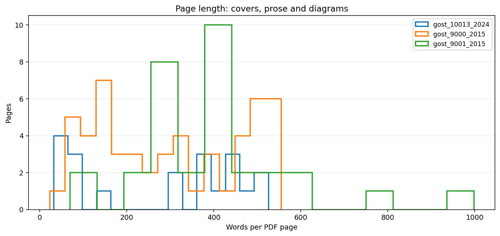
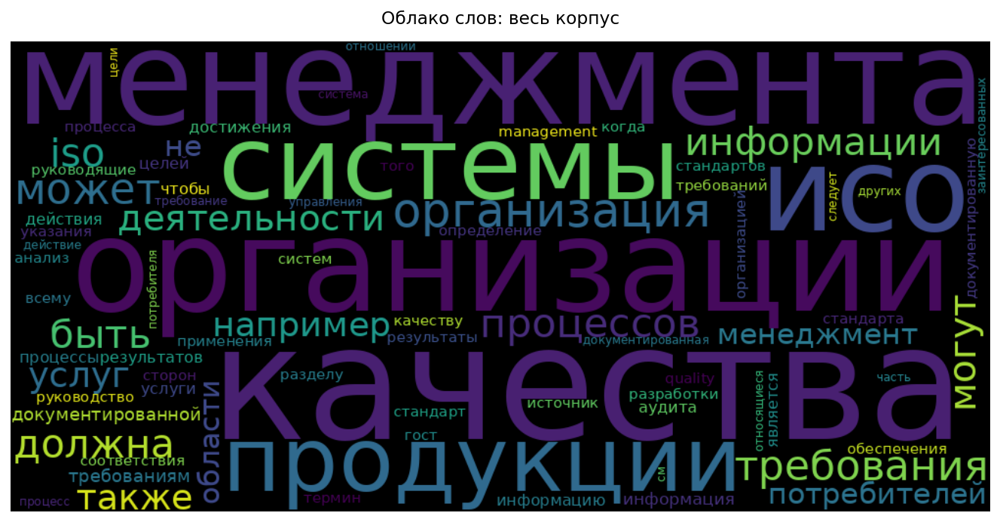
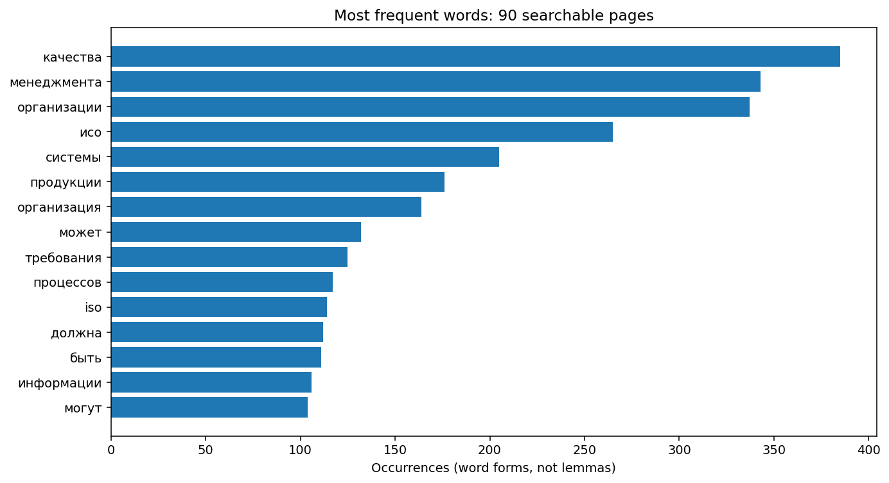
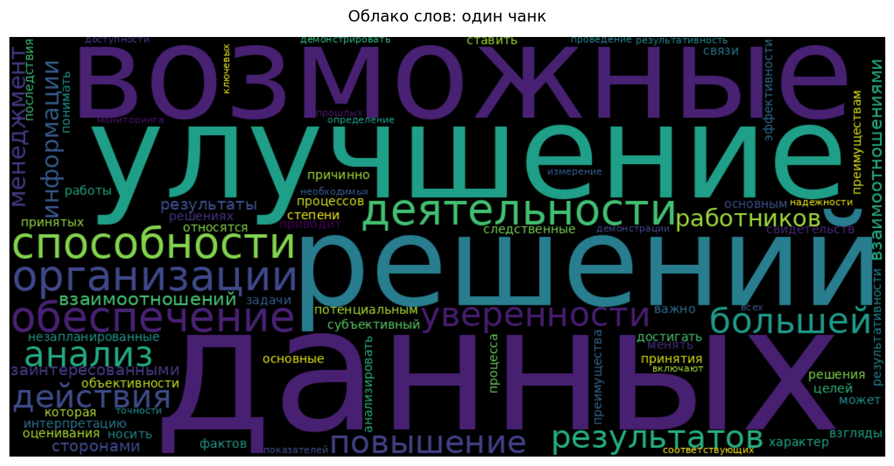
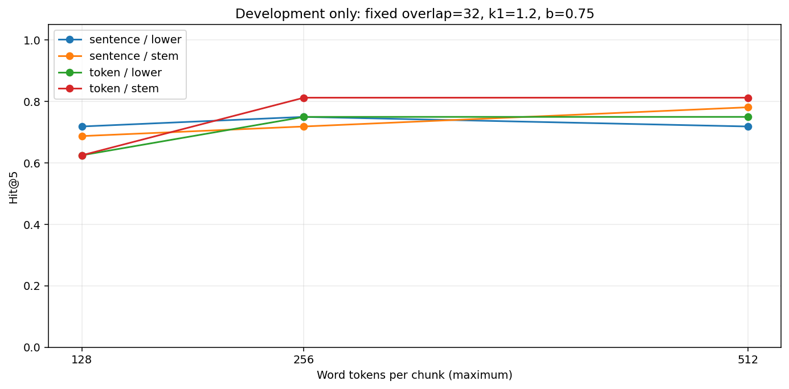
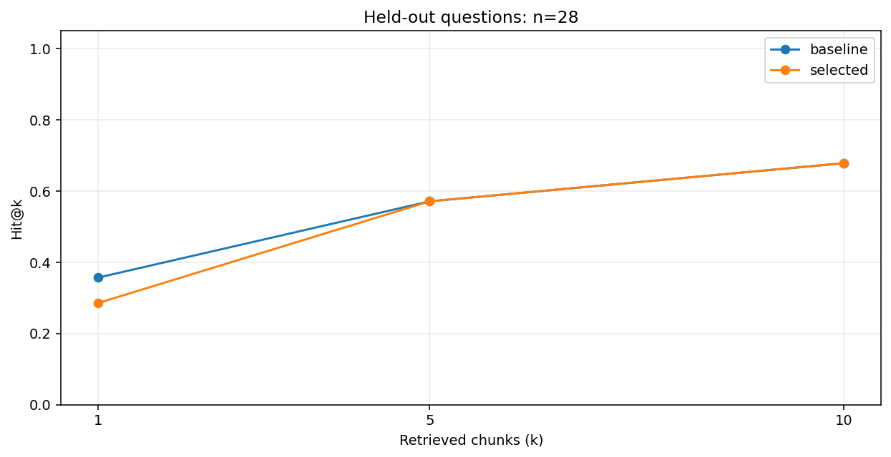
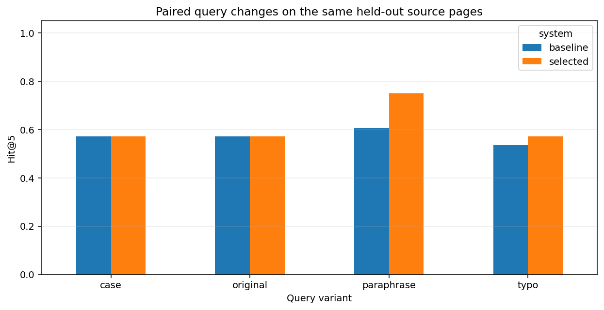

# Чекпойнт 02. Анализ ГОСТов и поиск BM25

10 ноября 2026. Три документа, 105 страниц PDF, 90 страниц в поиске. Основной вывод: настройка на малой выборке не гарантировала улучшение на отложенных вопросах.

## 1. Данные и происхождение

| document | pages | search_pages | tokens |
| --- | --- | --- | --- |
| gost_9000_2015 | 53 | 48 | 15100 |
| gost_9001_2015 | 32 | 27 | 11522 |
| gost_10013_2024 | 20 | 15 | 5014 |

Копии закреплены в [data/sources.json](data/sources.json): адрес, SHA-256 и границы страниц. Титул, служебные сведения и задние обложки не включены в поиск. Все 105 страниц остаются в аудите. Полные PDF не публикуются; загрузчик проверяет хеш перед расчетами.

Источники: [9000-2015](https://files.stroyinf.ru/Data2/1/4293759/4293759339.pdf), [9001-2015](https://files.stroyinf.ru/Data2/1/4293759/4293759338.pdf), [10013-2024](https://files.stroyinf.ru/Data/830/83016.pdf).

Это закрепленные редакции для эксперимента. Их действуущий нормативный статус на дату применения не проверялся.

## 2. Качество текста и дубликаты

В корпусе есть определения, требования и рекомендации. Короткие страницы с диаграммами не считаются автоматически мусором. В текстовом слое встречаются переносы, латиница среди русских терминов и разрывы слов пробелами. Очередность таблиц и рисунков не восстанавливается.

Очистка объединяет переносы и нормализует пробелы; исходный PDF остается неизменным. Пропуски, символ замены, доля латиницы и длина каждой страницы сохранены в [page_audit.csv](results/page_audit.csv).

Проверка SHA-256 находит точные повторы нормализованного текста. Нормализованное сходство Левенштейна при пороге 0.85 дает 0 пар страниц и 0 пар базовых чанков. Пары сохранены в [duplicate_candidates.json](results/duplicate_candidates.json). Они не удалялись автоматически: повтор определения в приложении может быть полезным, а соседние чанки перекрываются по настройке.

Векторные представления рассмотрены как способ поиска смысловых повторов, но не вычислялись в этом запуске. Векторная близость сама по себе не доказывает дубль.

## 3. Словарь корпуса

Облака построены по словоформам, без лемматизации. Базовый стоп-список убирает служебные слова; доменные слова сохранены. В панели можно сравнить режимы без стоп-слов, с базовым и расширенным списком. Это меняет только визуализацию, не индекс BM25. Частота не равна важности: IDF снижает вес слов, которые есть во многих чанках.

## 4. Вопросы и разделение

Ассистент составил по 20 вопросов на документ и по одной переформулировке: 60 основных вопросов и 60 парных вариантов. У каждого есть страница, раздел, символьный интервал доказательства и его SHA-256. Все записи помечены `human_review=false`. Происхождение сохранено в [generation.json](data/generation.json).

По страничным группам зафиксированы 32 вопроса для подбора и 28 для теста. Одна страница не попадает в обе части. Переформулировки наследуют группу исходного вопроса. Это внутридокументный синтетический тест, а не независимые вопросы реальных пользователей. Повторы определений на других страницах могут сохранять зависимость.

Вопросы не регенерируются при смене сплиттера. Релевантным считается чанк, который целиком покрывает хотя бы один интервал доказательства. Вопрос без такого чанка получает нуль, но не исчезает из знаменателя. Это строгое координатное правило; семантически подходящие не размеченные фрагменты могут считаться ошибкой. Необходима проверка полноты разметки.

Адаптер `questions.py` умеет обработать каждый документ или каждый базовый чанк через внешний API. Живой вызов API не выполнялся. Сравнение двух стратегий генерации не проведено; в этом корпусе использован документный режим.

## 5. Разбиение и протокол

Два сплиттера: окно слов и окно с предпочтением границ предложений. Размер означает максимум слов по одному регулярному выражению, не BPE-токены модели. Сетка: 128/256/512 слов, перекрытие 0/32, нижний регистр или русский Snowball-стеммер, k1=1.2/1.8, b=0.35/0.75. Всего 96 конфигураций.

BM25 использует положительный IDF: `log(1 + (N-df+0.5)/(df+0.5))`. Формула соответствует варианту из документации [Lucene](https://lucene.apache.org/core/9_12_1/core/org/apache/lucene/search/similarities/BM25Similarity.html). Пустой запрос и неизвестные слова не возвращают случайные нулевые совпадения. Равные оценки разрешаются по стабильному ID.

Базовый вариант: `token / 256 / overlap=32 / lower / k1=1.2 / b=0.75`.
По dev выбран: `{'strategy': 'token', 'size': 256, 'overlap': 32, 'mode': 'stem', 'k1': 1.8, 'b': 0.35}`.
Правило выбора: максимальный Hit@5, затем MRR@5, затем меньше слов контекста. Тест открывается только после фиксации выбора.

## 6. Фактические метрики

| system | k | hit | precision | recall | mrr | ndcg | questions |
| --- | --- | --- | --- | --- | --- | --- | --- |
| baseline | 1 | 0.3571 | 0.3571 | 0.3393 | 0.3571 | 0.3571 | 28 |
| baseline | 5 | 0.5714 | 0.1214 | 0.5714 | 0.4494 | 0.4776 | 28 |
| baseline | 10 | 0.6786 | 0.0714 | 0.6786 | 0.4649 | 0.5135 | 28 |
| selected | 1 | 0.2857 | 0.2857 | 0.2857 | 0.2857 | 0.2857 | 28 |
| selected | 5 | 0.5714 | 0.1214 | 0.5714 | 0.4000 | 0.4455 | 28 |
| selected | 10 | 0.6786 | 0.0714 | 0.6786 | 0.4116 | 0.4774 | 28 |

На 28 тестовых вопросах оба варианта находят доказательство в TOP-5 в 16 случаях, в TOP-10 в 19. В TOP-1 базовый вариант попадает 10 раз, выбранный на dev вариант 8 раз. Значит, выигрыш на подборе не подтвердился на основных тестовых формулировках. Менять выбор задним числом по тесту нельзя.

Парный групповой бутстреп по страницам для разности Hit@5 (selected - baseline): 95% интервал [-0.222; 0.185]. На такой малой выборке это разведочный интервал, не доказательство равенства систем.

Hit@k показывает наличие хотя бы одного доказательства. Recall@k считает долю всех размеченных релевантных чанков; при перекрытии их может быть несколько. Precision@k делится на к, даже когда выдача короче. MRR учитывает ранг первого попадания, nDCG оценивает весь порядок. Основной критерий между разбиениями: Hit@k вместе с числом слов контекста, поскольку число релевантных чанков зависит от разбиения.

### Срез по документам

| system | document_id | hit | mrr |
| --- | --- | --- | --- |
| baseline | gost_10013_2024 | 0.9000 | 0.7333 |
| baseline | gost_9000_2015 | 0.3000 | 0.2500 |
| baseline | gost_9001_2015 | 0.5000 | 0.3438 |
| selected | gost_10013_2024 | 0.8000 | 0.6833 |
| selected | gost_9000_2015 | 0.1000 | 0.0200 |
| selected | gost_9001_2015 | 0.8750 | 0.5208 |

### Примеры пропусков базового поиска в TOP-5

- q005: Как определяется постоянное улучшение? (PDF 14, gost_9000_2015)
- q013: Что считается несоответствием? (PDF 19, gost_9000_2015)
- q014: Что означает соответствие? (PDF 19, gost_9000_2015)

Полные ранги и адреса кандидатов сохранены в [predictions.jsonl](results/predictions.jsonl). Перед следующей итерацией нужно прочитать кандидатов и разделить пропуски словарного поиска, ошибки границ и неполноту разметки.

## 7. Аугментация запросов

| system | variant | hit | mrr | questions |
| --- | --- | --- | --- | --- |
| baseline | case | 0.5714 | 0.4494 | 28 |
| baseline | original | 0.5714 | 0.4494 | 28 |
| baseline | paraphrase | 0.6071 | 0.4643 | 28 |
| baseline | typo | 0.5357 | 0.3226 | 28 |
| selected | case | 0.5714 | 0.4000 | 28 |
| selected | original | 0.5714 | 0.4000 | 28 |
| selected | paraphrase | 0.7500 | 0.5429 | 28 |
| selected | typo | 0.5714 | 0.3940 | 28 |

Изменение регистра и пунктуации не меняет результат: нормализация работает одинаково в запросе и корпусе. Удаление одной буквы в длинном слове проверяет чувствительность к опечатке. Переформулировки созданы вместе с основными вопросами. Рост на них не доказывает улучшение на реальных пользователях. Не нужно аугментировать индекс дублями документов: это меняет IDF и может исказить сравнение.

## 8. Прототип и воспроизведение

`streamlit run checkpoint_02/streamlit_app.py`

Панель строит облака по корпусу, документу и выбранному чанку; показывает частоты, исходный текст, поиск и пересчет dev-метрик по ползункам. Таблица теста зафиксирована и не меняется от ползунков. Экран работает с настоящими данными и теми же модулями, что ноутбук. Детали запуска: [README.md](README.md).

Проверки: модульные тесты формул метрик, границ чанков, пустых запросов, хешей и разметки; Streamlit AppTest проверяет смену параметров и уровень чанка. Тест API использует подставной ответ. Факты о прогонах записаны в `results/validation.json` после проверки. Запуск в самом сервисе Google Colab не проводился; ноутбук проверен полным локальным выполнением.

## 9. Что делать дальше

Сохранить этот BM25 как точку отсчета. Приоритет: ручная проверка 60 вопросов, дополнение альтернативных доказательств и реальные вопросы специалистов. После этого проверить векторный поиск и реранкер на тех же данных. Веб-прототип не включает загрузку произвольных корпусов, граф цитирования и генерацию ответа. Этот этап реализует обработку PDF, поиск и оценку; остальные компоненты архитектуры не объявляются готовыми.

Практическая ценность и риски: [practical_value.pdf](practical_value.pdf).
